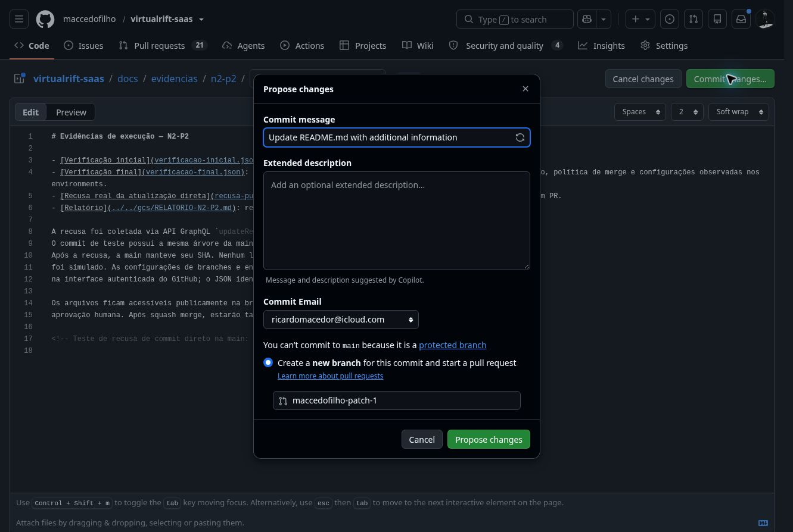

# Recusa real pelo site — Commit changes

- Data: 16/11/2026, aproximadamente 20:19 (UTC-03).
- Repositório: `maccedofilho/virtualrift-saas`.
- Sessão: proprietário `maccedofilho`.
- Branch: `main`.
- Arquivo de teste: `docs/evidencias/n2-p2/README.md`.
- Alteração tentada: comentário Markdown inofensivo, somente para verificar a proteção.

## Procedimento e resultado

1. Abrir o arquivo na main e clicar **Edit this file**.
2. Acrescentar o comentário de teste.
3. Clicar **Commit changes...**.
4. O GitHub apresentou **Propose changes** e bloqueou o commit direto:

> You can’t commit to main because it is a protected branch

A única opção disponível era **Create a new branch for this commit and start
a pull request**. Não havia opção de commit direto na main. Não foi usado bypass.

5. Cancelar o diálogo e descartar a edição. Nenhum commit/branch de teste foi criado.

Este é o teste pela interface do site, complementar à recusa via API já
registrada. Não se trata de uma execução de `git push` no terminal.

## Screenshot original

